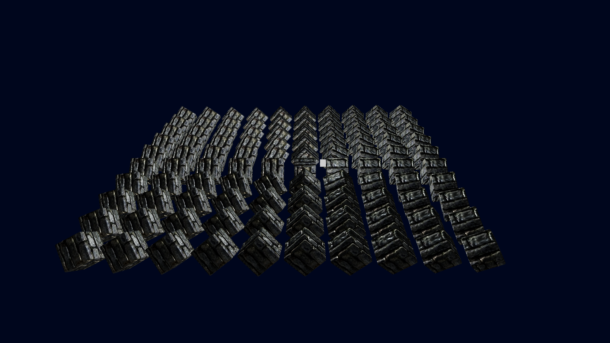

# Wrenderer

A simple renderer made in wgpu with light and shadow texture obj file load

## Description
* **Wgpu:** Made in wgpu to work in any place
* **Rust:** Build in rust to be memeory safe.
* **Texture:** support texture load.
* **Light:** Have phone base lighting and texture feature.
* **Cargo:** package got manage by cargo.
* **Lightwight:** uses the obj file to load model and have very lightweight.


## Demo



## Getting Started
- Uses wgpu
- Very lightwight
- Can run on window and linux (Tested only in Linux for now)

## Dependencies
- Need just rust compiler and cargo other things will get install automatically
- And if ur using binary then just computer

## Installing
- Just download the bin file or clone the repo and run command ```cargo run ```

## How to Run
To run the visual physics simulation:
```bash
cargo run 

```
## Help
if ur using already compiled bin then just wrenderer one(keep in mind that u need res.tar.z file just decompress here and then paste in same place and it will run).
```
 ./wrenderer
```
